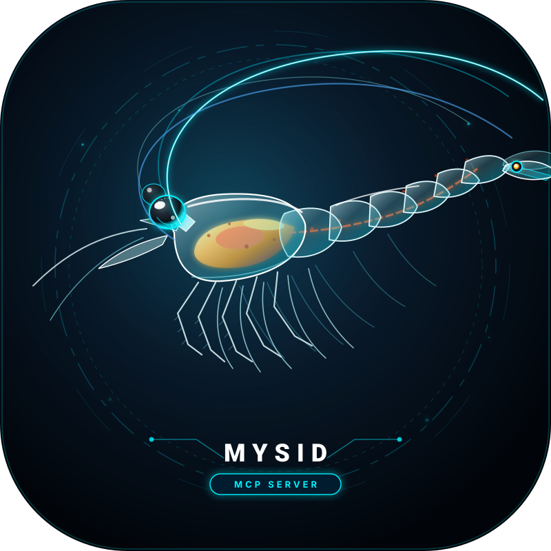

<p align="center">
  
</p>

<p align="center">
  
  
  
  
</p>

# mysid

A small, fast code-intelligence tool for LLM agents and developers. One Rust binary that works as a **command line** and as an
**MCP server**. It answers questions about a codebase in a few lines instead of dumping files, edits safely, builds, and keeps an
audit trail, so an agent spends tokens on the task and not on the tooling.

## Install

```powershell
.\install.ps1          # builds if needed, installs to %LOCALAPPDATA%\mysid\bin, adds it to PATH, registers the MCP server (Claude Code, Claude Desktop, Antigravity/Gemini)
mysid help
```

macOS and Linux (prebuilt binary, no Rust needed):

```sh
curl -fsSL https://raw.githubusercontent.com/bypreetham/mysid-mcp/main/install.sh | sh
mysid help
```

MCP clients (Claude Desktop, Antigravity/Gemini, Cursor, Cline): `{ "mcpServers": { "mysid": { "command": "mysid", "args": [] } } }`

### For agents: let Claude install it

Copy everything in the box below into Claude Code (or any assistant that can run commands). It downloads the latest prebuilt
mysid for this system from GitHub Releases (no Rust, no clone), puts it on `PATH`, registers the MCP server and checks that it works.

```text
Install mysid on this machine and set it up. The latest build is published at
https://github.com/bypreetham/mysid-mcp/releases/tag/latest

1. If `mysid help` already runs, skip to step 3.
2. Install, by system:
   - Windows (PowerShell):
       Invoke-WebRequest https://raw.githubusercontent.com/bypreetham/mysid-mcp/main/install.ps1 -OutFile "$env:TEMP\mysid-install.ps1"
       powershell -ExecutionPolicy Bypass -File "$env:TEMP\mysid-install.ps1" -Download
     It copies mysid.exe to %LOCALAPPDATA%\mysid\bin and adds that folder to my user PATH.
   - macOS or Linux:
       curl -fsSL https://raw.githubusercontent.com/bypreetham/mysid-mcp/main/install.sh | sh
     It picks the build for this system (Linux or macOS, x86_64 or arm64), checks its checksum, copies it to ~/.local/bin
     and adds that folder to my shell profile when it is not on PATH.
   Both scripts check that the download runs before replacing anything, and register the MCP server for Claude Code, Claude
   Desktop and Antigravity/Gemini when they are installed. If the `claude` command exists but registration was skipped, run:
     claude mcp add --scope user mysid -- mysid
3. Check it in a NEW terminal (this one has the old PATH): `mysid help` must print "mysid: code intelligence for LLM agents"
   and a numbered command list. If the command is not found, tell me which folder it was installed to and fix PATH.
4. Other MCP clients: add { "mcpServers": { "mysid": { "command": "mysid", "args": [] } } } to their config.
5. Tell me to restart the client, and that inside a project folder the first command is `mysid set .`, then `mysid help`.

Rules: change only what these steps say. Do not commit, push or edit any project. Do not touch my other MCP servers or
settings. Do not add yourself as an author or co-author anywhere. Report each step as done or failed, with the error text.
```

If there is no prebuilt file for a system (the installer says so), build from source: clone the repository, run
`cargo build --release` in `rust-mcp`, and copy `target/release/mysid` to a folder on PATH.

To update later, run the same installer again (it replaces the running copy safely) and reload the MCP client. Every file on
the release has its checksum in `SHA256SUMS`.

## The usual flow

Run it from inside the project folder. mysid finds the project from there, so several agents can work on several projects at
once. `mysid set <path>` is optional.

```
mysid list src/ui                 what is in a folder
mysid overview Player.kt          the outline: types and signatures, no code
mysid read Player.kt              the code (first 120 lines);  Player.kt#L121-240 for more;  or a symbol name
mysid search "retries" --types kt where is it
mysid graph StreamResolver        who calls it, what it calls  (no argument: where the code lives)
mysid apply  /  mysid patch ...   edit: many changes at once, or one exact replacement
mysid write src/New.kt --file x   new file (no shell quoting: stdin or --file)
mysid check  /  mysid build       verify: errors only
mysid checkpoint -> edits -> mysid diff -> mysid commit "msg"       undo: mysid restore --yes
```

File **names**, not paths (`Player.kt`). Output is capped and prints short names. Failures start with `NOT PATCHED`, `NOT APPLIED`,
`NOT WRITTEN` and exit with status 1. Nothing is ever pushed.

## For models

- `mysid help` is the flow above. `mysid help --claude` shows it in Claude Code's own tool names.
- `mysid skill base | android | react` print short workflow guides; `mysid skill install` writes them as Claude Code skills.
- Android commands (build stages, release, devices, Wi-Fi, device logs) are taught by `mysid skill android`.

## What is inside

| Part | What it does | Doc |
|---|---|---|
| Code index (SQLite, in `.mysid/`) | symbols, call graph, signatures; refreshed incrementally | [Indexer](README/Indexer.md) |
| `graph`, `list`, `overview`, `read` | orientation without file dumps | [graph](README/graph.md), [looking at code](README/looking-at-code.md) |
| `search` | parallel regex search with a lazily filled text index | [Indexer](README/Indexer.md) |
| Editing | `patch`, `apply`, `write`, `append` with CRLF-safe matching | [editing](README/editing.md), [file names](README/file-names.md) |
| Git helpers | `commit`, `history`, `checkpoint`, `diff`, `restore` | [commit and history](README/commit-history.md) |
| Build | detached worker with live stages and an errors-only report (Gradle, Cargo, npm) | [Android](README/android-dev.md), [exec and check](README/exec-and-check.md) |
| Android | release (versionCode bump, bundle, verification), devices, Wi-Fi, keyword and raw device logs | [Android](README/android-dev.md) |
| Web release | `mysid release` in a React project: build, `netlify deploy --prod`, live `.mysid/release.log` | [web release](README/web-release.md) |
| Dev server, deps | `mysid dev` (background server + URL + log), `mysid deps` (missing npm packages) | [dev and deps](README/dev-and-deps.md) |
| Project doctor | `mysid doctor compare <old> <new>`: files, size, identical / changed / moved / one-sided, and whether the old folder can be deleted | [project doctor](README/project-doctor.md) |
| Shell-free chores | `--head/--tail/--grep` on any command, `mysid test`, `mysid status`, `mysid copy` | [shell-free](README/shell-free.md) |
| Projects | `mysid new react <name>` | [new project](README/new-project.md) |
| Workspaces | one project per folder, per command, no shared state | [workspaces](README/workspaces.md) |
| Skills | workflow guides for models | [skills](README/skills.md) |
| Where data lives | `.mysid/` in the project, `%LOCALAPPDATA%\mysid` per user | [agent data](README/agent-data.md) |

## Build from source

```powershell
cd rust-mcp
cargo build --release      # rust-mcp/target/release/mysid.exe
cargo test
```

Layout: `rust-mcp/src/` (`tools/` the commands, `index/` the code index, `textindex/` the search index, `parsers/` per language,
`adapters/` per stack), `rust-mcp/skills/` the guides built into the binary, `README/` the documentation.

## Why "mysid"?

A mysid is a small, adaptable crustacean that moves through complex water and finds what it needs. The tool does the same in a codebase:
small, quick, and good at finding the right context.

Apache 2.0, see [LICENSE](LICENSE).
